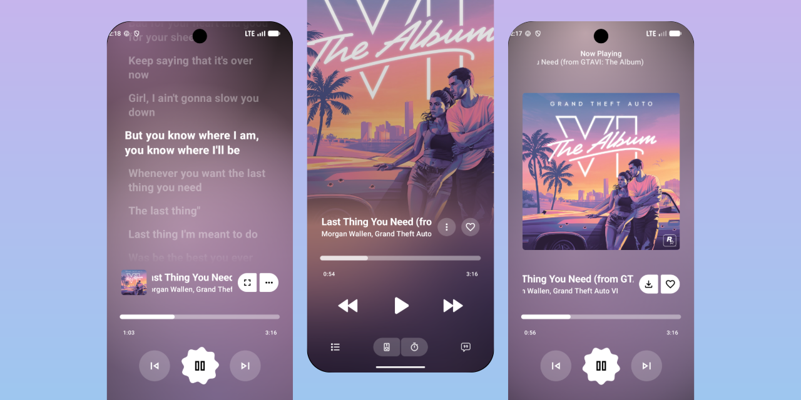
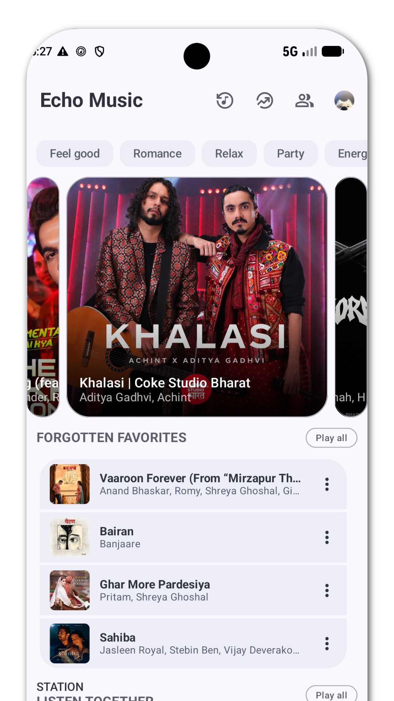
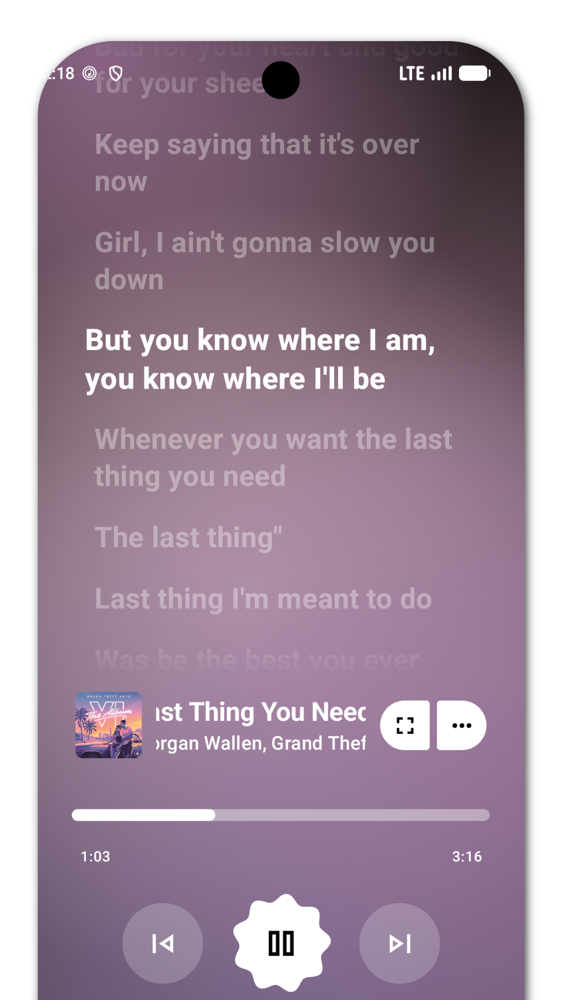
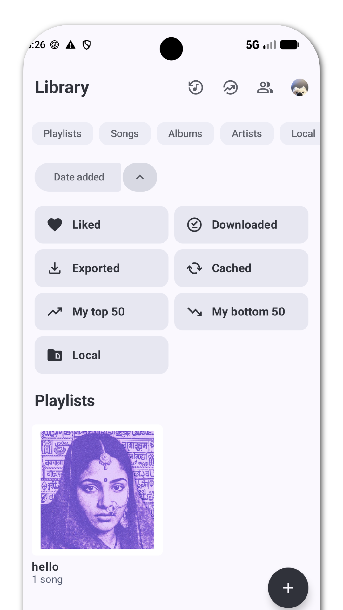

<div align="center">
  

  <p><b>A free, open-source Android music player for streaming, discovery, lyrics, and offline listening.</b></p>
</div>

---

Echo Music brings together music playback, synchronized lyrics, discovery, and a customizable listening experience.

## Features

- Stream music with background playback and an offline library.
- Follow synchronized lyrics, including word-by-word timing and translation options.
- Discover tracks with music recognition and personalized recommendations.
- Customize the player, playback behavior, and interface.
- Add optional extensions for 320 kbps and lossless audio sources.

## Screenshots

<div align="left">
  <table style="margin: 0 auto; border-collapse: collapse;">
    <tr>
      <td align="center" style="padding: 15px; border: none;">
        <b>Home Screen</b><br><br>
        
      </td>
      <td align="center" style="padding: 15px; border: none;">
        <b>Material Player</b><br><br>
        
      </td>
      <td align="center" style="padding: 15px; border: none;">
        <b>Apple Style Player</b><br><br>
        
      </td>
    </tr>
    <tr>
      <td align="center" style="padding: 15px; border: none;">
        <b>Synchronized Lyrics</b><br><br>
        
      </td>
      <td align="center" style="padding: 15px; border: none;">
        <b>Search & Explore</b><br><br>
        
      </td>
      <td align="center" style="padding: 15px; border: none;">
        <b>Music Library</b><br><br>
        
      </td>
    </tr>
  </table>
</div>

## Optional audio extensions

- [320 kbps audio extension](https://github.com/EchoMusicApp/320kbs-extension)
- [Lossless audio extension](https://github.com/EchoMusicApp/lossless-extension)

Configure extension sources in the app's **Settings → Extensions**. See each extension repository for setup instructions.

## Install

Download the latest APK from [Releases](https://github.com/techprem324/Echo-Music/releases/latest).

## Build from source

1. Clone this repository:

   ```bash
   git clone https://github.com/techprem324/Echo-Music.git
   cd Echo-Music
   ```

2. Configure the Android SDK in `local.properties`. See [SETUP.md](SETUP.md) for platform-specific setup and optional Firebase configuration.

3. Build the universal GMS debug variant:

   ```bash
   ./gradlew assembleUniversalGmsDebug
   ```

   On Windows, use `gradlew.bat assembleUniversalGmsDebug`.

## Notes

Echo Music is an independent open-source project and is not affiliated with YouTube or Google. It does not host media; users are responsible for following applicable laws and service terms.

## License

Licensed under [GPL-3.0](LICENSE).
